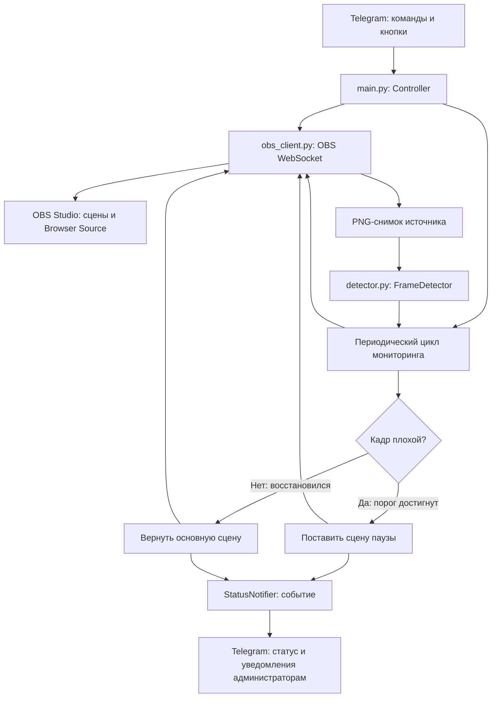

# Архитектура и алгоритм работы

[← README](../README.md) · [Конфигурация](CONFIGURATION.md) · [Диагностика](TROUBLESHOOTING.md)

## Структура исходного проекта

```text
OBS Control/
├── .env.example         # пример токена бота и ID администратора
├── .gitignore
├── config.example.json  # начальные параметры OBS и мониторинга
├── detector.py          # анализ PNG-кадра
├── main.py              # Telegram-бот, состояние и сценарии управления
├── obs_client.py        # обращения к OBS WebSocket
└── requirements.txt     # зависимости Python
```

## Компоненты

### `main.py`

Содержит:

- точку входа `main()` / `run()` и настройку **aiogram**;
- обработку Telegram-команд, кнопок и диалогов ввода;
- `Controller`: конфигурацию, права доступа, управление сценами и циклом проверок;
- `StatusNotifier`: закрепляемое статусное сообщение, историю событий и временные push-уведомления;
- фоновые корутины мониторинга (`monitor_loop`) и удаления уведомлений (`cleanup_loop`).

OBS-запросы выполняются преимущественно через `asyncio.to_thread`, чтобы блокирующий WebSocket-клиент не останавливал обработку Telegram. Изменения конфигурации и действий OBS сериализуются через `asyncio.Lock` (`action_lock`); для заявок пользователей есть отдельная блокировка.

### `obs_client.py`

Класс `OBSClient` работает через пакет `obsws-python`:

- создаёт соединение `ReqClient` по мере необходимости и вызывает методы OBS WebSocket;
- получает версии, сцены, коллекции, профили, состояние вещания и записи;
- получает PNG-скриншот источника OBS;
- получает Browser Source из списка входов OBS (`browser_source`);
- меняет видимость элемента сцены и отправляет запрос обновления Browser Source;
- при аудиоисключении подключает `EventClient` к событиям `INPUTVOLUMEMETERS`, собирает уровни звука и анализирует свежесть данных.

При сетевых ошибках клиент пытается закрыть соединение; последующие запросы могут установить его заново. Доступ к экземпляру клиента дополнительно защищён блокировкой потока.

### `detector.py`

`FrameDetector.inspect()` декодирует скриншот, накладывает прозрачность на чёрный фон, переводит в градации серого, обрезает по `crop`, масштабирует до `160×90` и вычисляет:

- долю пикселей, попавших под порог чёрного;
- стандартное отклонение яркости;
- среднюю абсолютную разницу между текущим и предыдущим кадром;
- продолжительность интервала, в течение которого разница между соседними кадрами не превышает порог.

Результат возвращается как объект `Inspection` с полями `reason`, `black_fraction`, `stddev`, `frame_difference`, `frozen_for`. Если обнаружена активная проблема, `reason` содержит текст причины.

## Взаимодействие компонентов



Это схема логических связей: на практике решение также зависит от актуальной сцены, разрешения по звуку и текущего состояния автоматики.

## Состояние автоматического мониторинга

Объект `Controller` хранит:

| Поле | Смысл |
| --- | --- |
| `state.enabled` | Разрешена ли автоматическая проверка с переключением сцен. |
| `state.owned_fallback` | Перевёл ли бот OBS на сцену паузы самостоятельно. |
| `state.rules` | Активные пороги детектора. |
| `bad_count` | Число последовательных плохих проверок. |
| `good_count` | Число последовательных хороших проверок. |
| `last_inspection` | Последний результат анализа кадра. |
| `last_validation_error` / `last_error` | Последняя ошибка назначений / мониторинга. |

`state.enabled`, `state.owned_fallback` и правила сохраняются в `state.json`. Счётчики и последний анализ кадра находятся в памяти процесса и **не сохраняются** между перезапусками.

### Проверка перед включением

Вызов `/auto on` выполняет проверку:

1. Указаны источник, основная сцена и сцена паузы.
2. Активная коллекция совпадает с сохранённой.
3. Сцены существуют, имеют разные имена; источник существует и имеет тип Browser Source.
4. Текущая сцена OBS — **основная**.

Если условие не выполнено, бот возвращает причину отказа. Ручное изменение назначений и подключения OBS отключает автоматику.

### Шаг мониторинга

Упрощённо `Controller._tick_locked()` действует так:

```text
Проверить назначенные объекты OBS
Если они стали невалидны -> выключить автоматику и сообщить админам
Если автоматика выключена -> не анализировать кадр

Определить текущую сцену:
  если бот владеет паузой, а сцена уже другая -> выключить автоматику
  если бот не владеет паузой, а сцена не основная -> пропустить анализ

Получить PNG Browser Source -> оценить кадр
Если включено аудиоисключение и есть подтверждённый звук:
  плохой кадр считать допустимым

Если результат плохой -> увеличить bad_count, обнулить good_count
Иначе -> увеличить good_count, обнулить bad_count

Если кадр плохой и достигнут bad_checks ИЛИ время зависания:
  повторно проверить назначения и текущую сцену
  переключить OBS на сцену паузы и отметить owned_fallback=true
  отправить событие администраторам

Если бот владеет паузой и достигнут good_checks:
  повторно проверить назначения и текущую сцену
  вернуть OBS на основную сцену и снять owned_fallback
  обновить статус администраторам
```

**Приоритет аудиоисключения:** если оно разрешает проблемный кадр, переключения не происходит, в том числе по срабатыванию детектора зависания.

**Режим зависания:** кадр признаётся зависшим только при включённом `freeze` и достижении `freeze_seconds`; после этого переход на паузу не зависит от `bad_checks`. При этом порядок причин детектора — чёрный → однотонный → зависание.

### Тайминг и ошибки OBS

Стандартный интервал проверок — `3` секунды, с нижней границей `1` секунда. При ошибке соединения с OBS промежуток между попытками составляет **не менее 30 секунд** (`OBS_OFFLINE_RETRY_SECONDS=30`). Если соединение восстановилось, событие фиксируется в статусе.

При ошибках мониторинга бот записывает последнее сообщение, сбрасывает счётчики/измеритель звука и ограничивает повторные уведомления об одинаковой ошибке. При недействительных назначениях автоматика выключается. При обычном обрыве связи флаг включённой автоматики сам по себе не сбрасывается.

## Telegram и модель доступа

Доступ проверяется по Telegram ID **и типу чата**: команды управления принимаются в личных диалогах. Роли `viewer`, `operator`, `admin` определяют доступные пункты меню и обработчики. У неавторизованных пользователей доступен запрос прав; начальный администратор задаётся через `.env`.

Бот работает через **long polling**. Используется `Dispatcher`, обработчики команд и inline-кнопок, а для коротких последовательностей ввода — `FSMContext`. Состояние FSM находится в стандартном хранилище текущего процесса; при перезапуске незавершённые диалоги ввода не сохраняются.

## Система уведомлений

`StatusNotifier` хранит состояние в `notifications.json`, создаёт отдельное статусное сообщение для каждого администратора, повторно **редактирует** его при новых событиях и пытается закрепить в личном чате. При переходе на сцену паузы увеличивает счётчик за локальный день. Для push-событий использует ограничение частоты и запоминает время, после которого сообщение можно удалить. Фоновая корутина `cleanup_loop()` проверяет очередь удаления и при смене календарного дня обновляет доску состояния.

События типов `recovered` и `stream` не инициируют отдельный push, но обновляют статус. История событий ограничена **200** записями.

## Где хранятся данные

При старте `.env` подхватывается через `python-dotenv`, конфигурация читается из `settings.json` или мигрирует из `config.json`, иначе берётся `config.example.json`. Запись JSON выполняется через временный файл с последующей заменой целевого. Каталог с исходниками также служит каталогом для всех рабочих JSON-файлов.

Для резервного копирования настроек нужны как минимум `settings.json` и `state.json`; `notifications.json` хранит статус/историю и служебные ID Telegram.
